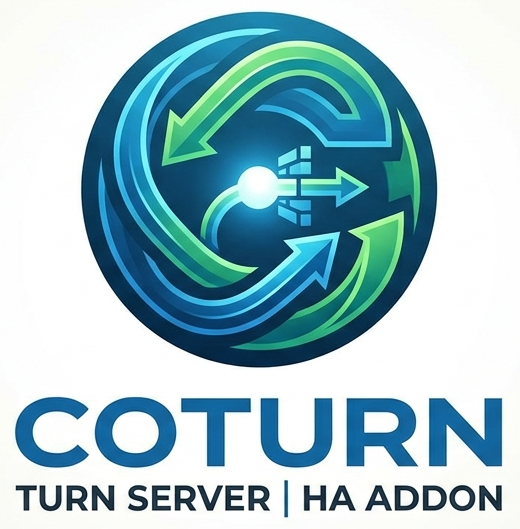

# 🔊 Coturn TURN Server Add-on

This Home Assistant add-on runs a **Coturn TURN/STUN server**, giving your self-hosted **Nextcloud Talk** (or any other WebRTC application) reliable audio/video calls for users behind NAT/firewalls — including external callers who aren't on your local network.

---

## 🔧 Based on

This add-on wraps [Coturn](https://github.com/coturn/coturn), the widely-used open-source TURN/STUN server, packaged as a Home Assistant OS add-on (Alpine-based, `s6-overlay` service) with configuration driven entirely through the Supervisor's Options UI.

---

## ⚙️ Configuration

| Option | Description | Example |
|--------|-------------|---------|
| `external_ip` | Your public IP or domain | `nc.yourdomain.com` |
| `static_auth_secret` | Random secret shared with your WebRTC app | generate with `openssl rand -hex 32` |
| `realm` | Your domain | `yourdomain.com` |
| `listening_port` | Unencrypted TURN/STUN port | `3478` |
| `tls_port` | Encrypted TURN/STUN port | `5349` |
| `use_tls` | Enable TLS | `true` |
| `cert_path` | Path to SSL certificate | `/ssl/fullchain.pem` |
| `key_path` | Path to SSL private key | `/ssl/privkey.pem` |
| `min_port` | Lower bound of the UDP relay port range | `49160` |
| `max_port` | Upper bound of the UDP relay port range | `49200` |

See [DOCS.md](DOCS.md) for the full walkthrough (secret generation, Nextcloud Talk setup, router port forwarding, certificate renewal).

---

## 🚀 Features

- 🐧 Minimal Alpine-based image, runs as an s6 service
- 🔐 Optional TLS (`turns:`) using your existing Home Assistant SSL certificate (`/ssl` mounted read-only)
- 🌐 Full configuration via Home Assistant Options — no manual config file editing
- 📡 `host_network` mode for correct NAT/relay behavior
- 🧱 Sane, restrictive defaults: denies relaying to private IP ranges (RFC1918), sensible allocation/channel/permission lifetimes, no CLI, no multicast peers
- 📝 Logs straight to stdout, viewable in the add-on log tab

---

## 🔄 How It Works

On start, the add-on reads your configured options and generates a `turnserver.conf` on the fly:

1. Validates that `static_auth_secret`, `external_ip`, and `realm` are set (refuses to start otherwise)
2. Builds the base TURN/STUN config (listening port, relay port range, auth secret, security hardening)
3. If `use_tls` is enabled and both `cert_path` and `key_path` exist, adds the TLS listener (`tls_port`) using your certificate; otherwise logs a warning and falls back to unencrypted-only
4. Launches `turnserver` with the generated config

---

## 🔐 Nextcloud Talk Setup

After starting the add-on, add the TURN server in **Nextcloud Admin → Talk**:

- `turn:yourdomain.com:3478` — UDP + TCP
- `turns:yourdomain.com:5349` — TLS

Use the same value as `static_auth_secret` as the shared secret.

---

## 🌍 Router Port Forwarding

| Port | Protocol | Purpose |
|------|----------|---------|
| 3478 | UDP + TCP | TURN/STUN |
| 5349 | UDP + TCP | TURN/STUN over TLS |
| 49160–49200 | UDP | Relay media stream (must be forwarded, or calls fall back to slow/unstable paths) |

---

## 🔁 Certificate Renewal

Coturn only reads the certificate at startup. Let's Encrypt renews certificates automatically, but Coturn won't pick up the new one on its own — **restart the add-on after every renewal**, or TLS keeps serving the old (soon-to-expire) certificate.

Recommended: a Home Assistant automation that restarts this add-on on a "certificate expiring" event (or simply monthly) via `hassio.addon_restart` with `addon: local_coturn`.

---

## ✅ Requirements

- A public domain with a valid SSL certificate (e.g. via Let's Encrypt)
- Router port forwarding for 3478, 5349, and the configured relay range (49160–49200 by default)
- `static_auth_secret` shared between this add-on and your WebRTC application (e.g. Nextcloud Talk)
