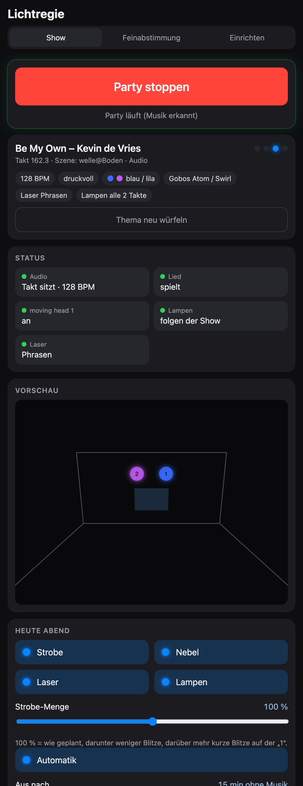
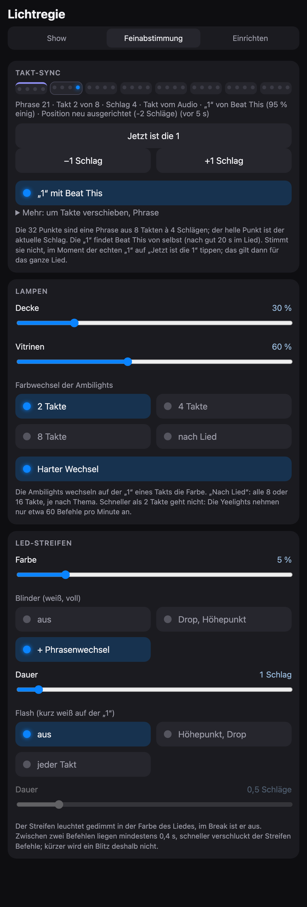

# Lichtregie

Musikgesteuerte Lichtshow für zwei Moving Heads, einen Laser und Lampen als Home-Assistant-Add-on. Die Köpfe werden
per Art-Net direkt angesteuert. Ton, Titel und Position im Lied kommen über einen eigenen AirPlay-Empfänger (Music
Assistant), Tempo und Stimmung aus der FreqBlog Music API, Schlag und „1“ aus der Live-Analyse und Beat This!.

## Was sie macht

- **Hört mit:** ein eigener AirPlay-Empfänger in der Sync-Gruppe von Music Assistant liefert Ton, Titel und die
  genaue Position im Lied aus einer Quelle.
- **Findet den Takt:** Live-Analyse für Schlag, Break und Drop; Beat This! (KI-Modell, im Add-on in numpy) für die
  „1“ und das genaue Tempo. Tempo und Stimmung kommen aus der FreqBlog Music API.
- **Spielt eine Show:** jedes Lied bekommt ein festes Thema (Farben, Gobos, Szenen, Laser-Rolle); Bahnen auf Boden,
  Wand und Decke, Dimmer-Pulse und Strobe im Takt, Höhepunkte und Drops.
- **Nimmt den Raum mit:** Ambilights und Vitrinen (Yeelight) in den Farben der Show, ein LED-Streifen hinter dem TV
  mit weißen Blindern und Flashes; danach kommt der alte Zustand zurück.
- **Spiegelkugel:** ein Kopf zielt in ruhigen Teilen auf die Kugel; ein zitterndes Gobo lässt die Lichtpunkte im Raum
  tanzen.
- **Party-Modus:** geht mit der Musik an und aus, schaltet Steckdosen, parkt die Köpfe.

| Show | Feinabstimmung |
|---|---|
|  |  |

- Anleitung: [DOCS.md](DOCS.md)
- Show-Design: [SHOW.md](SHOW.md), Konzept und Messwerte: [KONZEPT.md](KONZEPT.md)
- Entwicklung: `dev/test_all.sh` (Tests ohne Geräte), `dev/run_local.sh` (lokal starten), `dev/nachspielen.py` (Aufnahme vom Gerät
  durch die Analyse spielen), `dev/show_auswerten.py` (Stillstand und Ruckler in einer Aufnahme), `dev/messen/`
  (Werkzeuge aus der Kalibrierung)

## Beat This!

Die „1“ im Takt erkennt das Modell [Beat This!](https://github.com/CPJKU/beat_this) (Institute of Computational
Perception, JKU Linz, MIT-Lizenz, siehe `app/modelle/LIZENZ-beat-this.txt`), im Add-on in numpy nachgebaut.

## Tempo-Daten

Tempo und Stimmung der Titel kommen von der [FreqBlog Music API](https://freqblog.com/music-api.html).
Ursprünglich war [GetSongBPM](https://getsongbpm.com) als Quelle vorgesehen.
